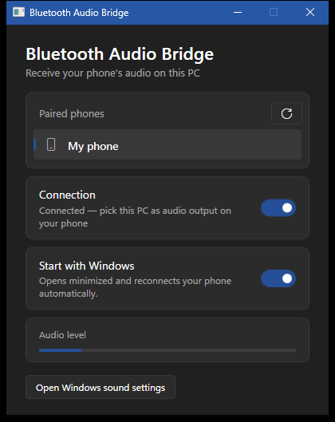
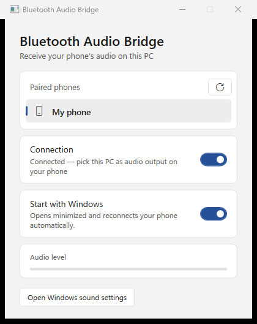

# Bluetooth Audio Bridge

[](https://github.com/Eredesboi/bluetooth-audio-bridge/releases/latest)
[](https://github.com/Eredesboi/bluetooth-audio-bridge/actions/workflows/build.yml)
[](LICENSE)


Use your Windows PC as a **Bluetooth speaker** for any phone or Bluetooth audio source (A2DP sink).
Free, open source, no account, no cloud, no telemetry, no network access.

```
Phone ──Bluetooth A2DP──▶ Windows ──▶ your default output device (speakers, headset, mixer…)
```

<p align="center">
  
  
</p>

## Features

- Connect a paired phone with one switch
- **Automatic reconnection**: the app remembers your phone and reconnects when it comes back in range
- Lives in the notification area; closing the window keeps it running
- Optional **Start with Windows** (starts hidden)
- Live audio level bar
- Native Windows 11 look, follows the Windows light/dark mode and accent color
- Works with any phone (iPhone, Android…), no app needed on the phone

## Download

Get the latest `BluetoothAudioBridge-…-win-x64.zip` from the [Releases page](https://github.com/Eredesboi/bluetooth-audio-bridge/releases/latest), unzip it and run `BluetoothAudioBridge.exe`. Nothing to install (.NET is bundled).

Requirements: Windows 10 version 2004 (build 19041) or later, or Windows 11, and a Bluetooth adapter that supports the A2DP sink role (most recent adapters do).

## Quick start

1. **Pair your phone once** in Windows: Settings › Bluetooth & devices › Add device.
2. Open the app, pick your phone in the list, turn on the **Connection** switch.
3. **On the phone, choose the PC as the audio output** (usually the output or cast icon in the music player or the quick settings panel). Without this step the sound stays on the phone, because the phone decides where audio goes.
4. Play something. The level bar moves and the sound comes out of your PC.

To get automatic reconnection at every login, also turn on **Start with Windows**. The app then starts hidden in the notification area (the `^` menu next to the clock). Right-click its icon › **Quit** to exit.

## Where does the sound go?

To the **default output device** of Windows (Settings › System › Sound › Output). Set the device you want as default; if you use a mixing app or a virtual audio device, make it the default output.

The app changes no Windows setting.

## How it works

Windows has no visible A2DP sink feature, but **Windows 10 2004+ and Windows 11 ship an official API**,
[`AudioPlaybackConnection`](https://learn.microsoft.com/uwp/api/windows.media.audio.audioplaybackconnection),
that opens the A2DP sink profile. Windows then receives, decodes and plays the stream itself. The app is the remote control for that feature: it opens the connection, keeps it alive and reconnects it.

| | |
|---|---|
| Driver or native code needed? | **No.** The API is usable straight from C#. |
| Access to the raw audio? | **No.** Windows plays the sound; apps cannot read it. |
| Choose the output device from the app? | **No.** Tested: Windows plays this stream on the default output device and ignores per-app output settings; capturing it returns silence. |
| Latency | That of the Bluetooth codec (SBC/AAC), roughly 100–200 ms. |

## Known limitations

- The sound always follows the Windows default output device (see above).
- One phone at a time.
- The audio level bar reads the Windows audio service session. Another Windows service playing sound at the same time can move it too.
- Tested on one Bluetooth adapter and one phone. Reports and pull requests are welcome.

## Build from source

Requires the [.NET 8 SDK](https://dotnet.microsoft.com/download/dotnet/8.0) (or newer) on Windows.

```powershell
git clone https://github.com/Eredesboi/bluetooth-audio-bridge.git
cd bluetooth-audio-bridge
dotnet run -c Release
```

Standalone single-file executable:

```powershell
dotnet publish -c Release -r win-x64 --self-contained -p:PublishSingleFile=true -p:IncludeNativeLibrariesForSelfExtract=true
```

## Project structure

| File | Role |
|---|---|
| `BridgeService.cs` | A2DP sink connection (`AudioPlaybackConnection`), paired device list, auto-reconnect loop |
| `Settings.cs` | Remembers the last phone and options (local JSON file, Start with Windows registry entry) |
| `LevelMeter.cs` | Audio level (read-only) via WASAPI, using NAudio |
| `Tray.cs` | Notification-area icon, hide on close |
| `MainWindow.xaml(.cs)` | Main window |
| `App.xaml(.cs)`, `Dark.xaml`, `Light.xaml`, `Themes.xaml` | Theme and shared styles |

Settings are stored locally in `%APPDATA%\BluetoothAudioBridge\settings.json` and never leave your PC.

Only dependency: [NAudio](https://github.com/naudio/NAudio) (MIT).

## Contributing

Issues and pull requests are welcome. Please keep the app small: no network access, no telemetry, no extra dependencies without a good reason.

## License

[MIT](LICENSE)
